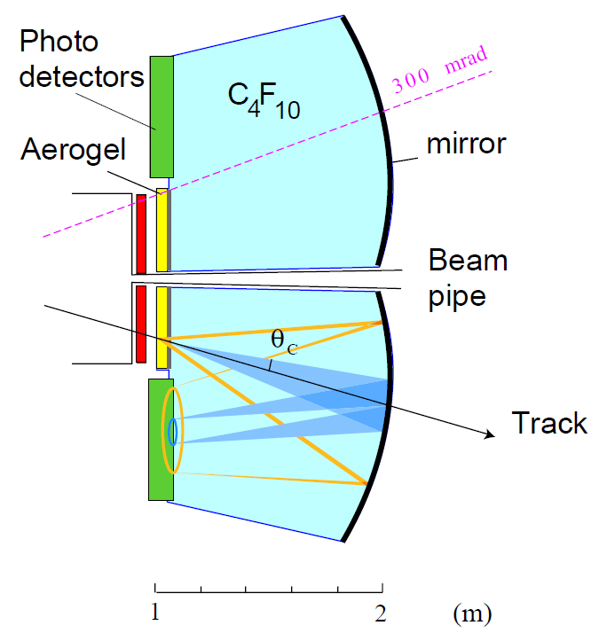

# Example RICH

Simulation of a Ring Imaging Cherenkov (RICH) detector with two radiators, silica aerogel and
C₄F₁₀ gas. The layout follows the RICH1 detector of LHCb as described in its Technical Design
Report.



## Physics

A charged particle that is faster than light in a medium (β > 1/n) emits Cherenkov photons
on a cone with half-angle cos θc = 1/(nβ). If the momentum is measured, the angle
gives the velocity and therefore the mass of the particle. A spherical mirror focuses all photons
with the same direction to the same point, so each cone appears as a ring on the photodetectors.
The radius of the ring is about θc·R/2, where R is the radius of curvature of the mirror.

Each radiator covers a different momentum range:

| Radiator | n | θc max (β = 1) | π threshold | K threshold | p threshold |
|---|---|---|---|---|---|
| Aerogel | 1.03 | 241 mrad | 0.6 GeV/c | 2.0 GeV/c | 3.8 GeV/c |
| C₄F₁₀ (at 3.2 eV) | 1.0014 | 53 mrad | 2.6 GeV/c | 9.3 GeV/c | 17.6 GeV/c |

## Detector

The detector is defined in `RICHDetector.jl`. All dimensions are keyword parameters of the
`RICHDetector` structure.

- **Gas vessel**: a box filled with C₄F₁₀ from z = 1 m to z = 2.1 m. The refractive index
  depends on the wavelength (Sellmeier formula).
- **Beam pipe**: a beryllium tube of 3 cm radius along z.
- **Aerogel**: a 5 cm tile at the entrance of the vessel, with a hole for the beam pipe (a
  `G4SubtractionSolid`). Rayleigh scattering length λ⁴/C, about 5 cm at 400 nm.
- **Mirrors**: two spherical mirrors (top and bottom) with R = 2 m and 90% reflectivity. Each is
  a spherical shell cut by a box (a `G4IntersectionSolid`), with a polished `dielectric_metal`
  optical surface. The centres of curvature are at y = ±75 cm, so each mirror is tilted and
  focuses its light onto the photodetector plane of the same half.
- **Photodetectors**: two planes at z ≈ 1 m, between |y| = 45 cm and 135 cm, outside the
  acceptance. Their quantum efficiency peaks at 25% around 400 nm.

## What the example does

1. Shoots one π⁺, K⁺ or proton per event from the origin. The momentum is uniform in log p between
   1 and 80 GeV/c, and the polar angle is between 50 and 250 mrad.
2. Records each optical photon that reaches a photodetector in the stepping action, and keeps
   it with a probability equal to the quantum efficiency.
3. Reconstructs the Cherenkov angle of each detected photon from the hit position and the track.
   The emission point is taken at the middle of the radiator. The reflection point on the mirror
   is found by a bisection in the plane of the emission point, the hit and the centre of
   curvature. The direction of aerogel photons is corrected for the refraction at the exit
   of the tile.
4. Produces the following plots:
   - the optical properties: C₄F₁₀ index, aerogel scattering length, quantum efficiency
   - an event display of a 10 GeV/c pion, with the geometry cut in half
   - the hits of 20 events on the photodetectors, where the aerogel and gas rings are visible
   - the reconstructed θc against the momentum, with the expected curves for π, K and p
   - the single photon resolution for each radiator
   - the mass reconstructed for each track from its average θc and momentum

With 1000 events the example gives about 21 detected photons per track from the aerogel and
27 from the gas. The single photon resolution is about 1 mrad for the aerogel and 2 mrad for the
gas, and π, K and p are well separated in both radiators.

## Running

```sh
julia --project=. advanced/RICH/RICH.jl
```

The script uses GLMakie and opens a window for each figure. It takes about 35 s. The notebook
`RICH.ipynb` uses CairoMakie and shows the figures inline.

To try other configurations, change the detector or generator parameters in `RICH.lit`. For
example:

```julia
rich = RICHDetector(aerogelRIndex = 1.01, mirrorReflectivity = 0.8)
generator = RICHGunGenerator(particles = ["pi+", "kaon+"], pmin = 5GeV, pmax = 30GeV)
```

## Simplifications

- One particle per event, and no magnetic field.
- The reconstruction takes the track direction and momentum from the generator, as if a tracking
  system measured them perfectly. It also takes the radiator of each photon from the Monte Carlo
  truth.
- The photodetectors have no pixels, so the hit position is exact.
- The aerogel refractive index is constant, so there is no chromatic dispersion for the aerogel.
  Its resolution is therefore better than for a real aerogel.
- The light goes directly from the spherical mirrors to the photodetectors. The final LHCb RICH1
  design adds flat secondary mirrors.
- The run uses one thread.

## Files

- `RICH.lit`: Literate source of the example (source of truth)
- `RICH.jl`, `RICH.ipynb`: script and notebook generated from `RICH.lit`
- `RICHDetector.jl`: detector parameters, materials, optical properties and geometry
- `Schematic-RICH-detector.png`: schematic of the detector

After you edit `RICH.lit`, regenerate the script and the notebook:

```julia
using Literate
Literate.script("advanced/RICH/RICH.lit", "advanced/RICH", name="RICH", keep_comments=false, documenter=true, credit=false)
Literate.notebook("advanced/RICH/RICH.lit", "advanced/RICH", name="RICH", execute=false, documenter=true)
```
